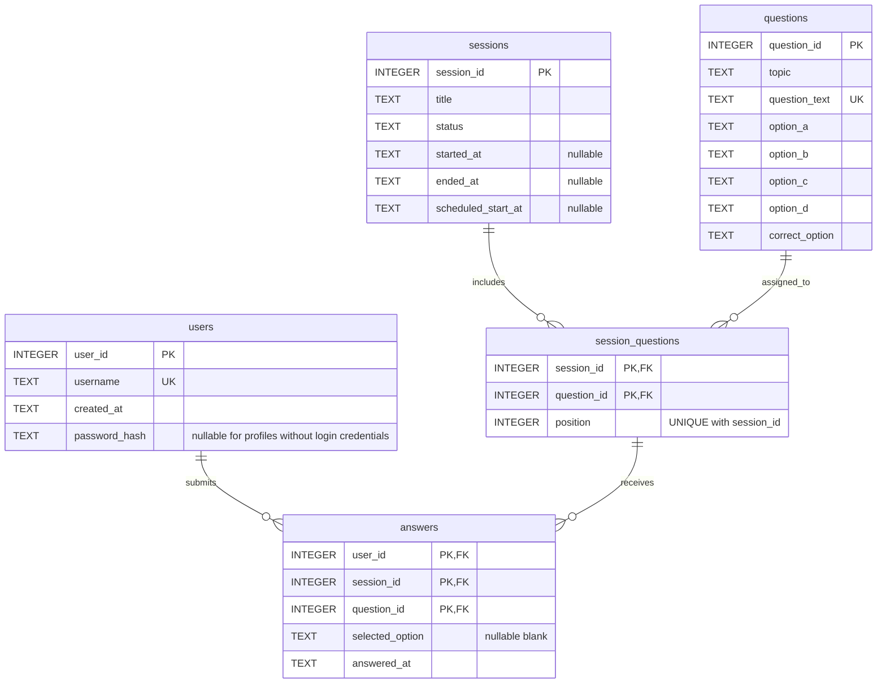

# CSQuiz entity relationship diagram

A simple diagram showing five tables, their columns and their keys.
The SVG file is the ready-to-view diagram; this is the editable source.

`answers(session_id,question_id)` references the **composite** primary key of
`session_questions`. An answer belongs to exactly one assigned question in one session.
`answers.user_id` separately references `users.user_id`.
All three answer identity columns together form its primary key.
`session_questions` additionally enforces UNIQUE(session_id,position).
One user or one assignment may have zero or many answer records.

The SVG connects relationships directly to their key rows:

- users.user_id → answers.user_id
- sessions.session_id → session_questions.session_id
- questions.question_id → session_questions.question_id
- session_questions.session_id → answers.session_id
- session_questions.question_id → answers.question_id

The last two lines are ONE composite foreign key, not two independent constraints.
Each relationship has one parent and zero or many child records. Each child references exactly one parent.
All 26 columns from schema.sql are included. PK markers in answers and session_questions form composite keys.
All UNIQUE constraints are shown. A question mark marks nullable columns; other columns are required.
The Mermaid source shows table relationships; the SVG shows the column connection points.
Validation conditions, defaults and triggers are defined in schema.sql.
